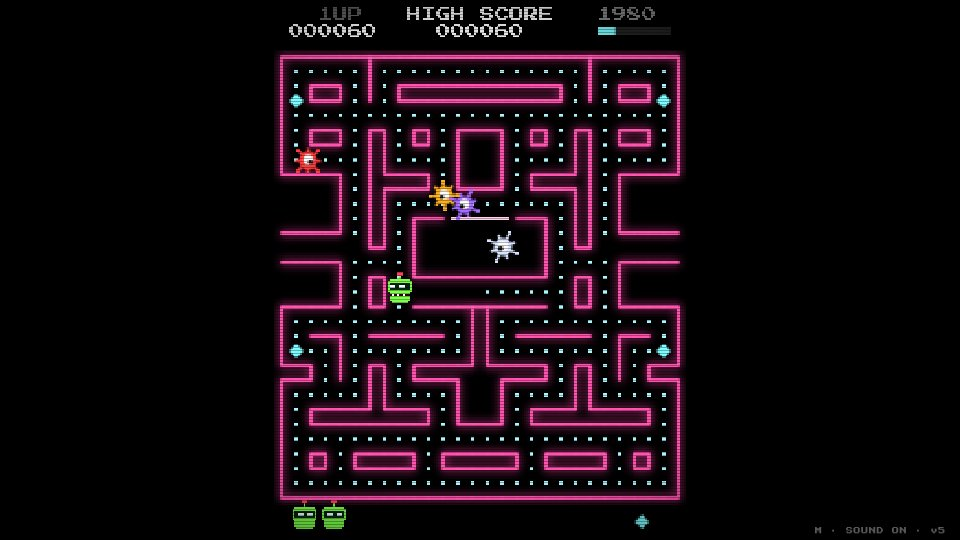
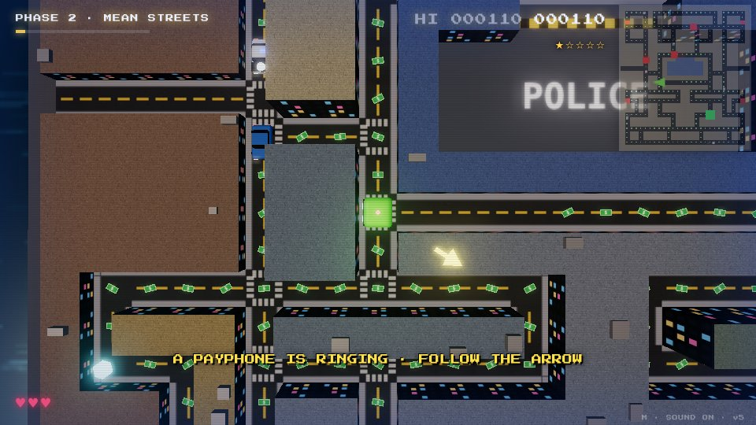
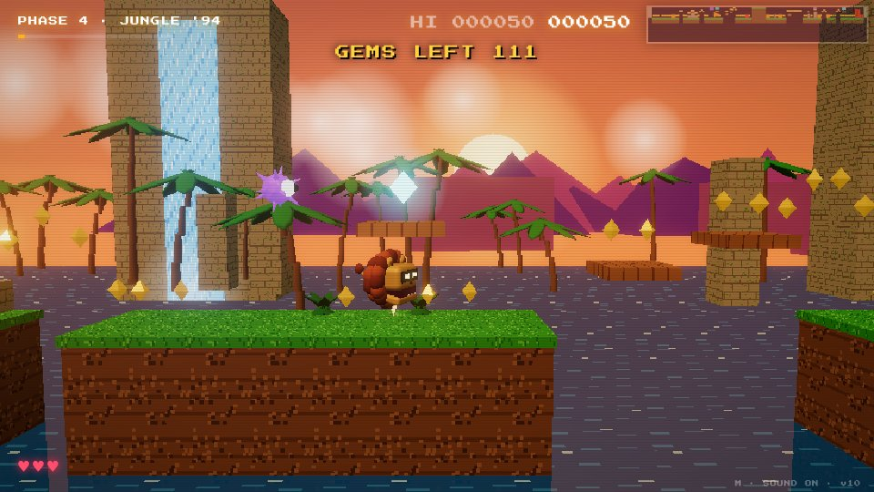

# MUNCHBOT '80

**A 1980 maze chase that turns into a crime city, a first-person shooter and a 16-bit jungle platformer.**

 

You are MUNCHBOT, a hungry little robot, and the Glitches are after you. It starts as an innocent 1980 arcade maze. After twenty seconds the machine OVERCLOCKS, there is no escape, GAME OVER... JUST KIDDING. The maze rises out of the screen and the real game starts.

## The phases

| | Phase | What happens |
|---|---|---|
| 1 | **1980** | A classic 2D maze: eat the dots, grab the power diamonds and eat the Glitches back. 20 seconds, then OVERCLOCK. |
| 2 | **MEAN STREETS** | The same maze rises into a top-down crime city. Grab all the cash to finish, answer ringing payphones for 3 jobs (a delivery run, a kill frenzy, surviving the heat), and dodge the glitch cop cars. The screen flashes red and blue as they close in. Collect 4 green tokens and your crew rolls in for 20 seconds and wrecks the cops for you. |
| 3 | **HELL MAZE** | First person with chunky pixels and rusty corridors. Demons hunt you (2 shots each), and so does THE BRUTE, a three-eyed boss demon that takes 5 shots and keeps coming back. Your arm cannon is the only gun in the maze and dots are ammo. Eat every dot to get out. |
| 4 | **JUNGLE '94** | A side-scrolling platformer in the spirit of 90s 16-bit games, built in real 3D. MUNCHBOT turns into a golden lion-bot with a mane: sunset jungle, ruins, waterfalls, pits, springy mushrooms and a moving log. Stomp the Glitches, double jump, and grab every gem (a counter shows how many are left) to open the gate at the end of the level. |
| 💀 | **BOSS: THE KERNEL** | A giant spiked core with bullet spirals, row and column lasers and slams. Eat a power core, then ram it five times. |

Phase 1 moves on by itself after 20 seconds. Phases 2 to 4 have no clock: you move on only when the map is cleared. Win and you can go again with **LOOP ×2**, faster every time.

 
 

## Controls

| | Keyboard | Phone |
|---|---|---|
| Steer (phases 1, 2, boss) | Arrows / `WASD` | Swipe |
| Run / jump (phase 4) | `←` `→` / `Space` or `↑` (again in the air for a double jump) | On-screen ◀ ▶ JUMP buttons |
| Walk (phase 3) | Hold `↑` / `W` | Hold a finger |
| Turn / turn around (phase 3) | `←` `→` / `↓` | Swipe left / right / down |
| Shoot (phase 3) | `Space` | Tap |
| Mute | `M` | |

**Secret level select:** type `222`, `333`, `444` or `555`. On a phone, tap the score 3 times quickly to skip to the next phase.

## Under the hood

- One single `index.html`, built from small source files. No image files: the maze, the city, the textures, the demons and the HUD are all drawn in code.
- 3D with [three.js](https://threejs.org) plus bloom, including a pixelated first-person mode and a pixelated side-scroller. All sound effects and music are generated live with the Web Audio API.
- Works on desktop and mobile, in landscape and portrait.

Run it locally by opening `index.html` in a browser, or with `python3 -m http.server`.

## More games in the series

| | |
|---|---|
| 🦖 [**404: Dino Not Found**](https://github.com/jeniaka/dino-404) | the offline dino runner that falls into 3D · [play](https://dino-404.pages.dev) |
| 👾 [**INVASION '78**](https://github.com/jeniaka/CrazySpaceShip) | a 1978 space shooter that turns into a 3D boss fight · [play](https://invasion78.pages.dev) |
| 🤖 **MUNCHBOT '80** | you are here |

Built by <a href="https://github.com/jeniaka">jeniaka</a> with Claude

