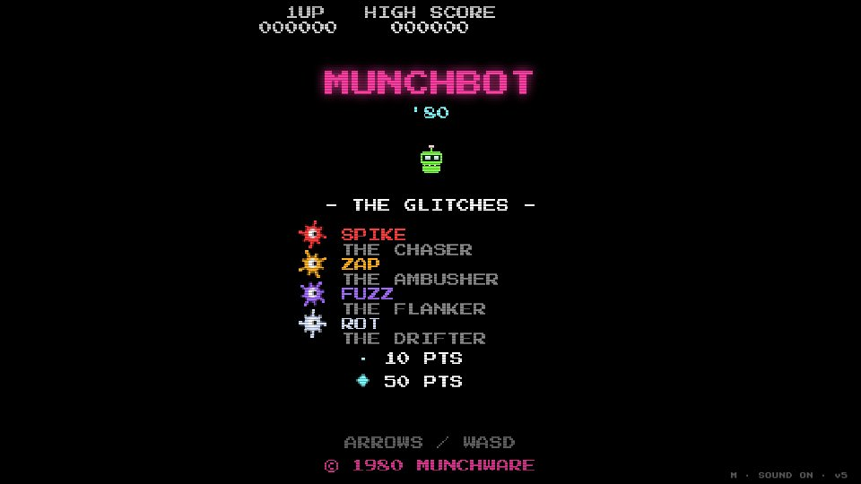
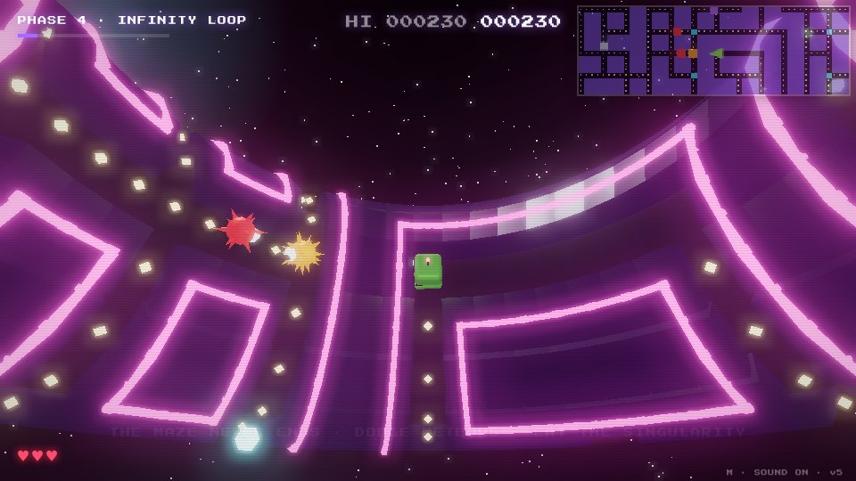
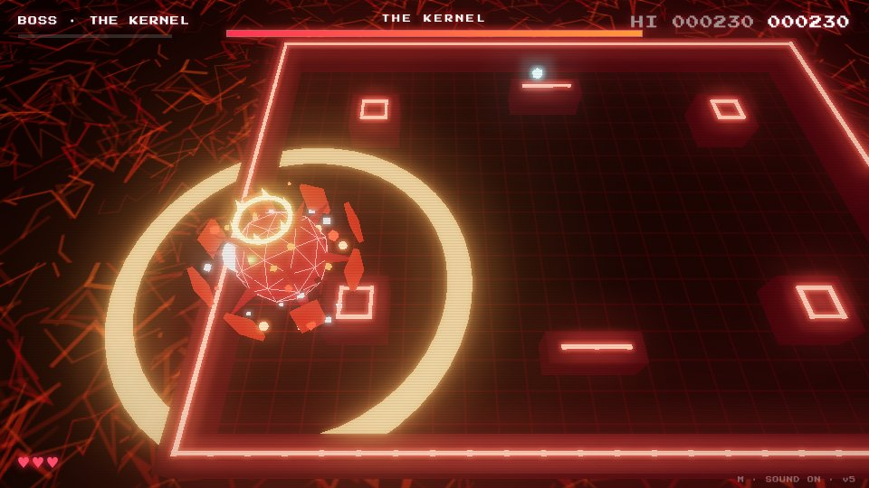

# MUNCHBOT '80

**A 1980 maze chase that turns into a crime city, a first-person shooter and a maze wrapped around a donut in space.**

 

You are MUNCHBOT, a hungry little robot, and the Glitches are after you. It starts as an innocent 1980 arcade maze. After twenty seconds the machine OVERCLOCKS, there is no escape, GAME OVER... JUST KIDDING. The maze rises out of the screen and the real game starts.

## The phases

| | Phase | What happens |
|---|---|---|
| 1 | **1980** | A classic 2D maze: eat the dots, grab the power diamonds and eat the Glitches back. 20 seconds, then OVERCLOCK. |
| 2 | **MEAN STREETS** | The same maze rises into a top-down crime city. Grab the cash, answer ringing payphones for 3 jobs (a delivery run, a kill frenzy, surviving the heat), and dodge the glitch cop cars. The screen flashes red and blue as they close in. |
| 3 | **HELL MAZE** | First person with chunky pixels and rusty corridors. Demons hunt you, your arm cannon is the only gun in the maze, dots are ammo. Health, kills and your face are on the status bar. |
| 4 | **INFINITY LOOP** | A maze wrapped around a torus in space that never ends. Meteors, a black hole you can eat, and a minimap that scrolls with you. |
| 💀 | **BOSS: THE KERNEL** | A giant spiked core with bullet spirals, row and column lasers, slams and minions. Eat a power core, then ram it five times. |

Win and you can go again with **LOOP ×2**, faster every time.

 
 

## Controls

| | Keyboard | Phone |
|---|---|---|
| Steer (phases 1, 2, 4, boss) | Arrows / `WASD` | Swipe |
| Walk (phase 3) | Hold `↑` / `W` | Hold a finger |
| Turn / turn around (phase 3) | `←` `→` / `↓` | Swipe left / right / down |
| Shoot (phase 3) | `Space` | Tap |
| Mute | `M` | |

**Secret level select:** type `222`, `333`, `444` or `555`, or tap the score 3 times quickly.

## Under the hood

- One single `index.html`, built from small source files. No image files: the maze, the city, the textures, the demons and the HUD are all drawn in code.
- 3D with [three.js](https://threejs.org) plus bloom, including a pixelated first-person mode. All sound effects and music are generated live with the Web Audio API.
- Works on desktop and mobile, in landscape and portrait.

Run it locally by opening `index.html` in a browser, or with `python3 -m http.server`.

## More games in the series

| | |
|---|---|
| 🦖 [**404: Dino Not Found**](https://github.com/jeniaka/dino-404) | the offline dino runner that falls into 3D · [play](https://dino-404.pages.dev) |
| 👾 [**INVASION '78**](https://github.com/jeniaka/CrazySpaceShip) | a 1978 space shooter that turns into a 3D boss fight · [play](https://invasion78.pages.dev) |
| 🤖 **MUNCHBOT '80** | you are here |

Built by <a href="https://github.com/jeniaka">jeniaka</a> with Claude

