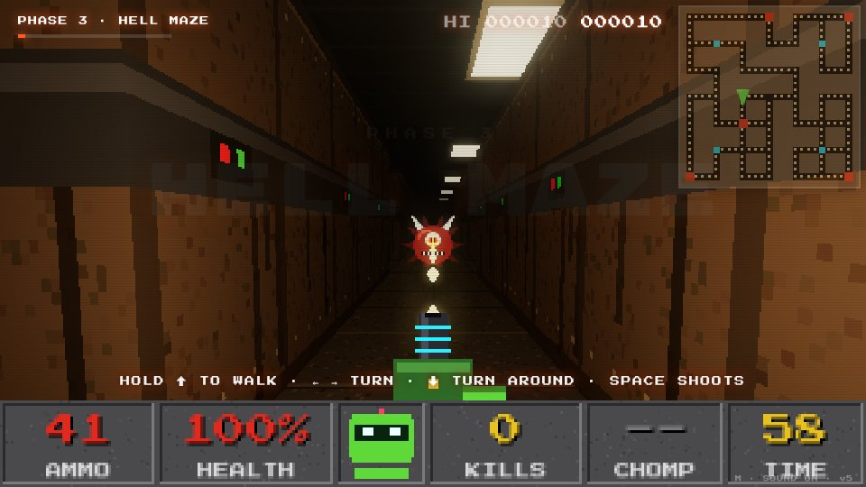
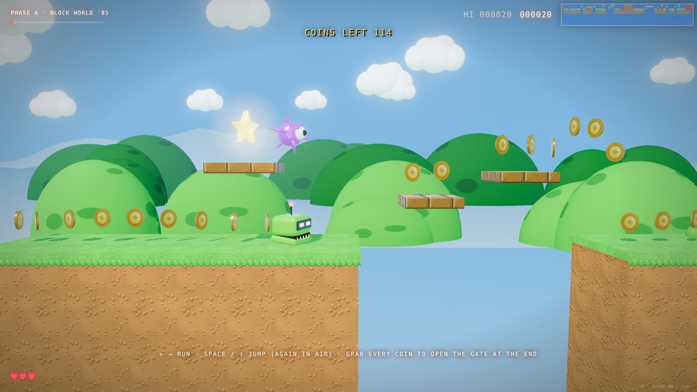
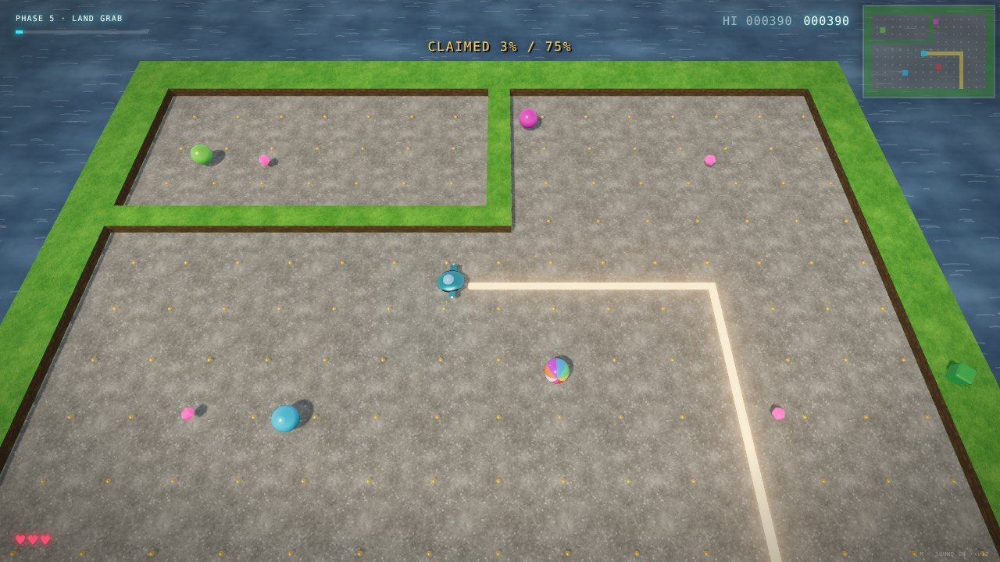

<div align="center">

# MUNCHBOT '80

**A 1980 maze chase that turns into a crime city, a first-person shooter, a classic block-world platformer and a 3D land grab.**

[](https://crazy-pacman.pages.dev)

 

</div>

You are MUNCHBOT, a hungry little robot, and the Glitches are after you. It starts as an innocent 1980 arcade maze. After twenty seconds the machine OVERCLOCKS, there is no escape, GAME OVER... JUST KIDDING. The maze rises out of the screen and the real game starts.

## The phases

| | Phase | What happens |
|---|---|---|
| 1 | **1980** | A classic 2D maze: eat the dots, grab the power diamonds and eat the Glitches back. 20 seconds, then OVERCLOCK. |
| 2 | **MEAN STREETS** | The same maze rises into a top-down crime city. Grab all the cash to finish, answer ringing payphones for 3 jobs (a delivery run, a kill frenzy, surviving the heat), and dodge the glitch cop cars. The screen flashes red and blue as they close in. Collect 4 green tokens and your crew rolls in for 20 seconds and wrecks the cops for you. |
| 3 | **HELL MAZE** | First person in rusty, bump-mapped HD corridors. Demons hunt you (2 shots each), and so does THE BRUTE, a three-eyed boss demon that takes 5 shots and keeps coming back. Your arm cannon is the only gun in the maze and dots are ammo. Eat every dot to get out. |
| 4 | **BLOCK WORLD '85** | A side-scrolling platformer in the spirit of the classic 80s/90s block worlds, built in real 3D: blue sky, puffy clouds, round green hills, brick steps, golden blocks, trampolines and a moving platform. Stomp the Glitches, double jump, and grab every coin (a counter shows how many are left) to open the brick gate at the end of the level. |
| 5 | **LAND GRAB** | Xonix meets Pac-Man, styled after AirXonix: a board floating on the ocean. Fly your hover craft off the green land to draw a line across the stone field, then close it: every pocket without a monster ball rises up as land and its pearls are eaten. Glossy balls bounce through the field and cut your line, and a green cube rolls along the land. Pink power gems turn them blue: eat them, or close a line around them to trap them for a big bonus. Claim 90% to win (95% on loop 2, 97% after that). |

Phase 1 moves on by itself after 20 seconds. Phases 2 to 5 have no clock: you move on only when the map is cleared (or claimed). Win and you can go again with **LOOP ×2**, faster every time.

<div align="center">
 
 
</div>

## Controls

| | Keyboard | Phone |
|---|---|---|
| Steer (phases 1, 2, 5) | Arrows / `WASD` | Swipe |
| Run / jump (phase 4) | `←` `→` / `Space` or `↑` (again in the air for a double jump) | On-screen ◀ ▶ JUMP buttons |
| Walk (phase 3) | Hold `↑` / `W` | Hold a finger |
| Turn / turn around (phase 3) | `←` `→` / `↓` | Swipe left / right / down |
| Shoot (phase 3) | `Space` | Tap |
| Mute | `M` | |

**Secret level select:** type the phase number three times (`222`, `333`, `444`, `555`). On a phone, tap the score 3 times quickly to skip to the next phase.

## Under the hood

- Plain HTML, CSS and JavaScript modules, no build step and no image files: the mazes, the city, the textures, the demons and the HUD are all drawn in code.
- 3D with [three.js](https://threejs.org): phase 1 stays a crisp 1980 arcade screen, while the 3D phases render in HD with soft sun shadows, multisampled anti-aliasing, bloom, sky-based reflections on paint, glass and metal, and high-res procedural textures with bump maps (asphalt, facades, rusty bricks, mossy ruins, palm fronds, neon maze tiles).
- A built-in quality governor steps the resolution and then the shadows down if a device can't hold the frame rate.
- All sound effects and music are generated live with the Web Audio API.
- Works on desktop and mobile, in landscape and portrait.

Run it locally with any static server from the repo folder (ES modules don't load from `file://`):

```
python3 -m http.server
```

then open http://localhost:8000.

## Project structure

```
index.html            page markup only
css/style.css         all styles
js/main.js            game flow: start / end phases, death, victory, main loop, keys
js/core/              utils, shared state (GS), input, audio + music, maze logic, the shared maze game
js/engine/            renderer, lights + sun shadows, quality governor, procedural textures,
                      maze world builder, models, particles, camera, 3D actors, skies
js/ui/                HUD and minimap
js/phases/            one file per phase + index.js (the phase list) + _template.js
```

A new phase is a new file in `js/phases/` plus one line in `js/phases/index.js`. The phase object
(start, tick, sync, outro, HUD, minimap...) is documented in [js/phases/README.md](js/phases/README.md),
and [_template.js](js/phases/_template.js) is a complete small phase to copy.

## More games in the series

| | |
|---|---|
| 🦖 [**404: Dino Not Found**](https://github.com/jeniaka/dino-404) | the offline dino runner that falls into 3D · [play](https://dino-404.pages.dev) |
| 👾 [**INVASION '78**](https://github.com/jeniaka/CrazySpaceShip) | a 1978 space shooter that turns into a 3D boss fight · [play](https://invasion78.pages.dev) |
| 🤖 **MUNCHBOT '80** | you are here |

<div align="center"><sub>Built by <a href="https://github.com/jeniaka">jeniaka</a> with Claude</sub></div>
